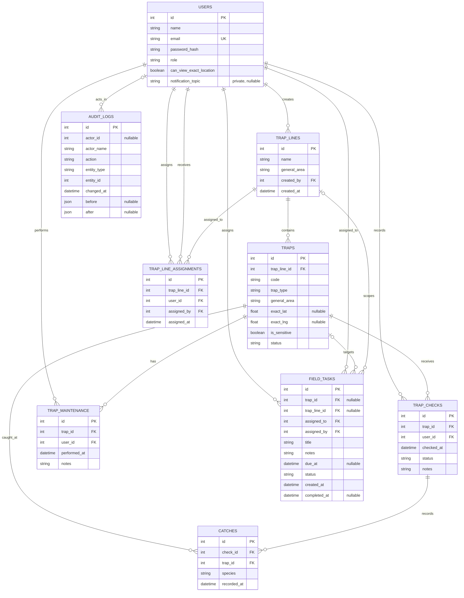

# Pest-Free Tracker ERD

This entity-relationship diagram reflects the SQLAlchemy tables and foreign
keys defined in `app/db/models.py`.

## Relationship notes

- One user can create multiple trap lines. Each trap line records its creator.
- One trap line can contain multiple traps. Each trap belongs to one line.
- A trap can have multiple checks and maintenance records; each record is
  associated with the user who recorded or performed it.
- A catch references both the check when it was recorded and the trap where it
  was caught.
- Trap coordinates are optional. Exact locations can be sensitive, with access
  controlled separately from the other trap details.
- A field task can target either a trap line or an individual trap, and records
  its assignee, creator, due date, and completion state.
- Trap-line assignments connect volunteers or field workers to lines. The
  `assigned_by` value records the coordinator who made the assignment.
- Audit entries retain actor names and before/after snapshots. Entity IDs are
  polymorphic rather than foreign keys, so deleted records remain auditable.
- A user's personal notification topic is nullable and private; API responses
  expose only whether one is configured.
- `email` is unique. `PK` marks a primary key; `FK` marks a foreign key; `UK`
  marks a unique field.
