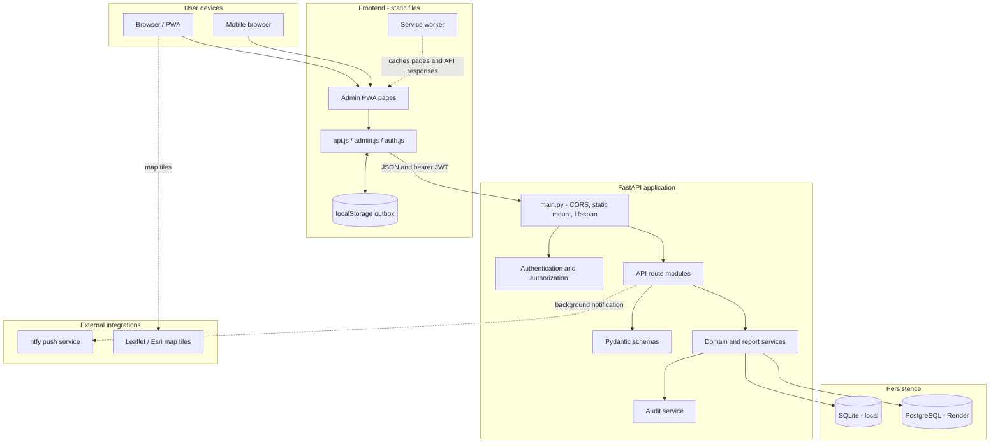
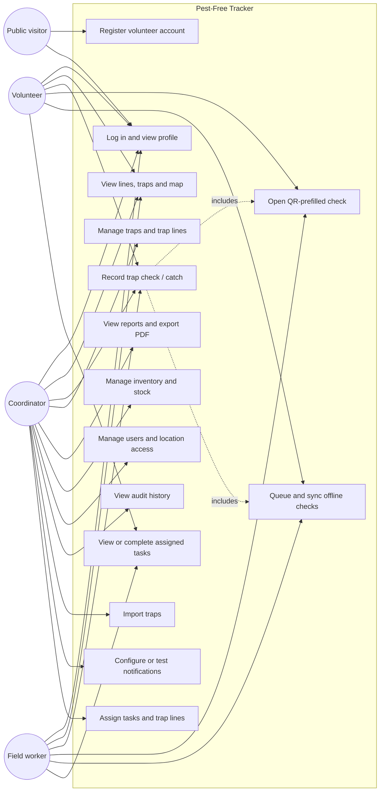
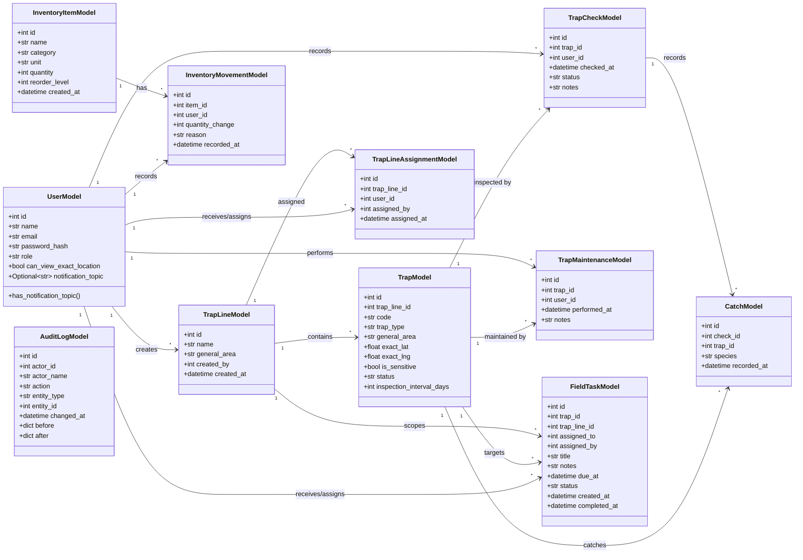
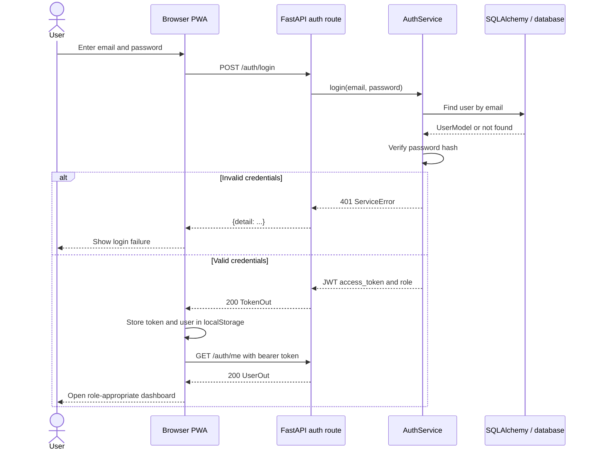
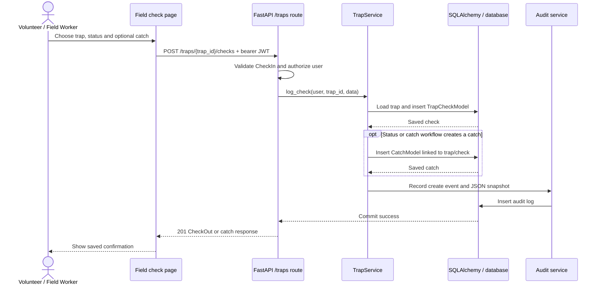
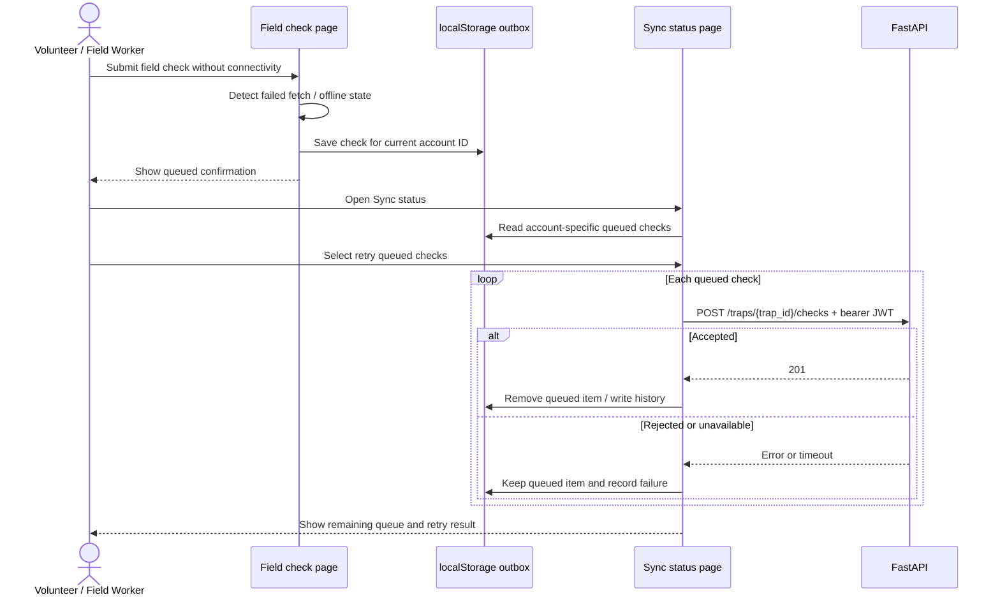
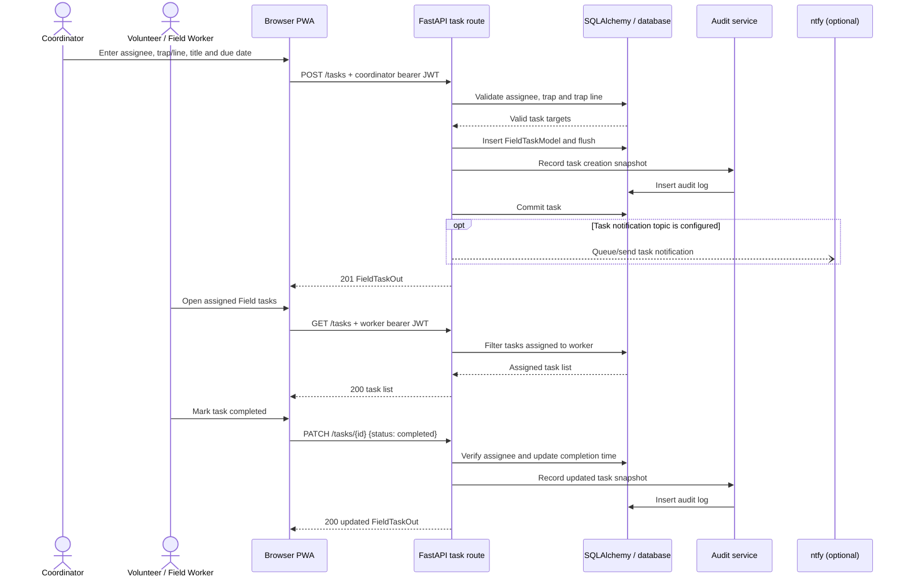

# Pest-Free Tracker technical documentation

## 1. System overview

Pest-Free Tracker is a Python/FastAPI application with a server-rendered/static browser frontend. The backend provides JSON APIs and serves the files in `frontend/`. Authentication uses JWT bearer tokens. SQLAlchemy reads and writes the configured relational database.

When installed as a PWA, browser pages are cached by a service worker. Failed field checks are stored in `localStorage` and retried later.

## 2. Technology stack

- Python 3 and FastAPI
- Pydantic 2 request/response schemas
- SQLAlchemy 2 ORM
- SQLite for local development
- PostgreSQL/SQLAlchemy for hosted deployments
- PyJWT authentication
- bcrypt password hashing
- Uvicorn ASGI server
- Browser HTML/CSS/JavaScript
- Bootstrap and Bootstrap Icons
- Leaflet and Esri map tiles
- Chart.js, jsPDF/export support and browser print-to-PDF
- QRCode.js
- Service Worker/PWA APIs
- ntfy for optional notification delivery
- pytest and FastAPI TestClient

## 3. Project structure

```text
app/
  api/                    Route modules
  db/                     SQLAlchemy engine, models and repositories
  services/               Domain, auth, reports and audit services
  config.py               Environment configuration
  main.py                 FastAPI app and router registration
  schemas.py              Pydantic request/response validation
  seed.py                 Destructive local seed
  seed_demo.py            Non-destructive API-based demo seed
  create_coordinator.py   Interactive hosted/local coordinator creation
  reminders.py            Scheduled reminder command
frontend/
  index.html              Public entry page
  admin/                  Login and administration PWA pages
  assets/                 Shared public assets
  admin/assets/js/        Frontend API, auth and page logic
  admin/sw.js             PWA shell/API/tile caching
  admin/manifest.json     PWA metadata

tests/                    pytest suite
 docs/                    Project documentation
README.md                 Project quick-start and operations
requirements.txt          Python dependencies
pestfree.db               Default local SQLite database, if created
```

## 4. Architecture

```text
Browser/PWA
  -> frontend/admin/assets/js/api.js
  -> FastAPI routes in app/api/*.py
  -> Pydantic validation in app/schemas.py
  -> SQLAlchemy repositories/services
  -> SQLite or PostgreSQL

  FastAPI static mount serves frontend/ at /
  JWT bearer token identifies protected requests
  ntfy is called as an optional outbound notification integration
```

The frontend uses same-origin API calls by default. `frontend/admin/assets/js/config.js` sets `API_URL` to `location.origin` for normal web origins and port 8000. If the frontend is not served on those origins, it uses `http://127.0.0.1:8000`. In a separate deployment, edit that file deliberately; do not commit secret values.

### Architectural diagram



The browser communicates with FastAPI over HTTPS or localhost. The service worker and local outbox provide page/API caching and queued field checks; they are not an alternative database. The FastAPI static mount serves both frontend and API from one origin in the normal deployment.

### Use case diagram



Role behavior is defensive, not a security boundary. Hidden navigation items do not replace backend authorization. Public users can register only volunteers on hosted Render deployments; coordinators create privileged accounts through user management or trusted setup.

### Class diagram

The diagram below represents the source `app/db/models.py` entities and the main relationships declared in the database model. It omits Pydantic DTO classes, which are request/response validation structures rather than persistent domain objects.



### Sequence diagrams

#### Sign-in and JWT authorization



#### Record an online trap check and catch



The exact catch workflow depends on which frontend action is used: `/traps/{trap_id}/checks` creates a check, and `/checks/{check_id}/catches` can attach a catch to that check.

#### Queue a field check while offline



#### Coordinator assigns and completes a field task



## 5. Database schema

The SQLAlchemy models in `app/db/models.py` create tables at application startup.

### Tables and relationships

| Table | Purpose | Foreign keys |
|---|---|---|
| `users` | Accounts, role, exact-location permission and private notification topic | None |
| `trap_lines` | Named trap lines | `created_by -> users.id` |
| `traps` | Trap identity, status, coordinates and inspection interval | `trap_line_id -> trap_lines.id` |
| `inventory_items` | Bait/equipment/maintenance stock definitions | None |
| `inventory_movements` | Audited stock changes | `item_id -> inventory_items.id`, `user_id -> users.id` |
| `trap_maintenance` | Maintenance notes | `trap_id -> traps.id`, `user_id -> users.id` |
| `trap_checks` | Trap inspections/status | `trap_id -> traps.id`, `user_id -> users.id` |
| `catches` | Catch records attached to checks/traps | `check_id -> trap_checks.id`, `trap_id -> traps.id` |
| `audit_logs` | Actor/action/entity snapshots | `actor_id` is stored but not a declared FK |
| `trap_line_assignments` | Line assignment to a user | `trap_line_id -> trap_lines.id`, `user_id -> users.id`, `assigned_by -> users.id` |
| `field_tasks` | Worker task and completion state | `trap_id -> traps.id`, `trap_line_id -> trap_lines.id`, `assigned_to -> users.id`, `assigned_by -> users.id` |

### Relationship diagram

```text
users 1 ─── * trap_lines (created_by)
users 1 ─── * trap_checks
users 1 ─── * trap_maintenance
users 1 ─── * inventory_movements
users 1 ─── * field_tasks (assigned_to)
users 1 ─── * field_tasks (assigned_by)
users 1 ─── * trap_line_assignments (user_id)
users 1 ─── * trap_line_assignments (assigned_by)

trap_lines 1 ─── * traps
trap_lines 1 ─── * trap_line_assignments
trap_lines 1 ─── * field_tasks

traps 1 ─── * trap_checks
traps 1 ─── * catches
traps 1 ─── * trap_maintenance
traps 1 ─── * field_tasks

inventory_items 1 ─── * inventory_movements
trap_checks 1 ─── * catches
```

Delete behavior is enforced partly in route code rather than cascade declarations. For example, deleting a trap manually removes related catches, checks and maintenance. Deleting a user is rejected when the user has recorded checks.

## 6. Backend routing

Routes are modular and registered in `app/main.py`:

- `app/api/auth.py`: registration, login, token and current user
- `app/api/users.py`: user creation/profile/location/topic operations
- `app/api/trap_lines.py`: lines and trap creation/listing
- `app/api/traps.py`: checks/history/maintenance
- `app/api/checks.py`: catch routes
- `app/api/admin_edit.py`: trap/user editing and deletion
- `app/api/reports.py`: catch aggregation
- `app/api/inventory.py`: inventory CRUD and movements
- `app/api/tasks.py`: tasks and assignments
- `app/api/audit.py`: audit history
- `app/api/imports.py`: bulk trap import
- `app/api/ntfy.py`: notification info/test delivery
- `app/api/reports.py` and `app/services/reports.py`: report aggregation

FastAPI startup creates all mapped tables and then calls `upgrade_legacy_schema()`.

## 7. Environment variables

| Variable | Required | Default | Purpose |
|---|---|---|---|
| `DATABASE_URL` | For deployment | SQLite path under project | SQLAlchemy database URL |
| `SECRET_KEY` | Required on Render | Development-only fallback locally | JWT signing |
| `RENDER` | Set automatically on Render | Unset | Enables hosted-only validation |
| `DUE_AFTER_DAYS` | No | `14` | Due threshold used by reminders |
| `OVERDUE_AFTER_DAYS` | No | `30` | Overdue threshold used by reminders |
| `NTFY_TOPIC` | For notification use | Empty; local fallback exists | Global ntfy topic |
| `NTFY_SERVER` | No | `https://ntfy.sh` | ntfy server URL |
| `NTFY_TOKEN` | For protected ntfy topics | Empty | ntfy bearer token |
| `BACKUP_DIR` | For automatic backups | Repository `backups/` | Persistent directory mounted for database backup archives |
| `BACKUP_CRON_TOKEN` | For automatic backup cron | Empty | Shared secret accepted only by `X-Backup-Cron-Key` |
| `BACKUP_RETENTION_COUNT` | No | `30` | Maximum number of retained backup archives |

Example local PowerShell values:

```powershell
$env:DATABASE_URL = "sqlite:///C:/path/to/project/pestfree.db"
$env:SECRET_KEY = "<generate-a-long-random-secret>"
```

Never commit real secrets or database URLs. The project contains no `.env.example` at present. Configure environment variables in the shell or hosting provider.

For a PostgreSQL URL beginning with `postgres://`, `app/config.py` converts it to `postgresql://` and then to the installed `psycopg2` driver URL. Supplied credentials remain hosting-provider configuration and must not be written into source control.

## 8. Windows local setup

1. Install Python 3 and confirm it is available:

   ```powershell
   py --version
   ```

2. Open the repository and create a virtual environment:

   ```powershell
   py -m venv .venv
   .\.venv\Scripts\Activate.ps1
   ```

   If PowerShell blocks script execution, use an approved environment policy or run the environment's `python.exe` directly.

3. Install dependencies:

   ```powershell
   python -m pip install --upgrade pip
   python -m pip install -r requirements.txt
   ```

4. Run the application:

   ```powershell
   python -m uvicorn app.main:app --reload
   ```

5. Open:

   - App: `http://127.0.0.1:8000/admin/login.html`
   - Swagger: `http://127.0.0.1:8000/docs`
   - ReDoc: `http://127.0.0.1:8000/redoc`

Use HTTPS or localhost for browser geolocation and service-worker/PWA features.

## 9. Database setup and migration

### SQLite

The default database URL resolves to `pestfree.db` beside the repository. Do not use a sample/reset command against data you need to keep.

At startup:

1. `Base.metadata.create_all()` creates missing tables.
2. `upgrade_legacy_schema()` adds missing `traps.status`, `traps.inspection_interval_days`, and `users.notification_topic` columns to existing SQLite/PostgreSQL-inspectable schemas.

There is no Alembic configuration in this repository. Schema changes that require more than the existing startup checks must be handled deliberately by data migration and backup/restore procedures.

Use a trusted local backup utility:

```powershell
python -m app.backup create --output C:\secure-backups\pestfree.db
```

Stop the app before restoration. Restore is supported only for SQLite:

```powershell
python -m app.backup restore --input C:\secure-backups\pestfree.db
```

### Seed choices

Full local reset seed:

```powershell
python -m app.seed
```

This drops all tables and recreates sample data. It is not safe for hosted production data.

API-based demo seed:

```powershell
python app/seed_demo.py http://127.0.0.1:8000 <coordinator-email> <coordinator-password>
```

It logs in and uses public APIs, skips existing lines/traps/tasks/inventory and may create one field-worker account. It is safer for a demo server but still changes data.

## 10. Testing

The tests use a SQLite database in `test_pestfree.db`, configured before app imports in `tests/conftest.py`. Each test resets tables through the fixture.

Run the complete suite:

```powershell
python -m pytest -q
```

Run a single file:

```powershell
python -m pytest tests/test_api.py -q
```

The suite covers authentication, authorization, trap and catch behavior, user/location visibility, field tasks, inventory, database structure and reminders. The repository documentation should state only that tests exist and pass locally when they have actually been run. Some deployment features, especially live ntfy delivery and browser PWA behavior, require manual verification.

## 11. Frontend integration

The static admin shell is built by `frontend/admin/assets/js/admin.js`. `config.js` supplies the API origin and due thresholds. `api.js` adds bearer authorization and handles JSON requests/offline queueing.

### Role navigation

- Field worker: Field check, Field tasks and Sync status.
- Volunteer: Dashboard plus non-coordinator pages; cannot use coordinator-only frontend menu items.
- Coordinator: all pages, including Reports, QR, Inventory, Audit, Users and management controls.

Backend authorization remains authoritative. Hidden frontend controls are not an API security boundary.

### Offline behavior

- `localStorage.outbox` stores unsent checks.
- `localStorage.syncHistory` stores recent upload outcomes.
- The service worker caches app pages, scripts, API GET responses and map tiles.
- Private API cache keys are derived from the authorization header.
- Failed checks are retried from Sync status or on app connectivity changes.
- The service worker must be served over HTTPS or localhost.

Image/photo upload is not implemented.

## 12. Deployment on Render

The project README indicates Render configuration is based on a web service serving the FastAPI application and a PostgreSQL database.

### Web service

Use a Python environment and a command equivalent to:

```text
python -m uvicorn app.main:app --host 0.0.0.0 --port $PORT
```

Configure:

- `DATABASE_URL`: managed PostgreSQL connection
- `SECRET_KEY`: long, unique, generated secret
- `RENDER`: set by Render
- Optional notification variables: `NTFY_TOPIC`, `NTFY_SERVER`, `NTFY_TOKEN`
- Optional reminder thresholds: `DUE_AFTER_DAYS`, `OVERDUE_AFTER_DAYS`

When `RENDER` is set, startup fails if `SECRET_KEY` is missing. Public registration is then limited to volunteer accounts.

### Database

Use the PostgreSQL service's connection URL supplied by Render. The application converts supported `postgres://` forms to a SQLAlchemy URL. Do not place the live database URL in source control or screenshots.

On each deployment, startup creates missing tables and checks for the two newly introduced trap columns and the notification topic column. A formal versioned migration system is not present. Test schema upgrades against a restore or disposable copy before production deployment.

### HTTPS and PWA

Use the HTTPS Render URL for service workers, install prompts and device location. The frontend's same-origin mode works when it is served by the FastAPI static mount. If the frontend is deployed separately, set `API_URL` in `frontend/admin/assets/js/config.js` to the API origin and ensure CORS/TLS routing are correct.

### Notifications

The project may send notifications with ntfy for trap creation, catch creation, task assignment, line assignment and reminders. Global topic configuration is optional. The deployed server may use `NTFY_TOPIC`; a protected topic may also require `NTFY_TOKEN`. Personal worker topics are at least 16 characters and are private to server-side user storage.

For scheduled reminders, create a separate Render Cron Job using `python -m app.reminders`, with the same database and notification environment variables as the web service.

### Automatic database backups

The `POST /backups/create` endpoint builds a compressed JSON archive of every SQLAlchemy table. It is invoked once daily at `02:00 UTC` by [render.yaml](../render.yaml). The cron job sends `X-Backup-Cron-Key` to the public HTTPS web service and requires no database credentials or coordinator account.

Render deployment requirements:

1. Attach a persistent disk to the web service and mount it at `/var/data/pestfree-backups`.
2. Set `BACKUP_DIR=/var/data/pestfree-backups`, `BACKUP_RETENTION_COUNT=30`, and a unique `BACKUP_CRON_TOKEN`.
3. Set `BACKUP_BASE_URL` on the cron job to the web-service HTTPS origin.
4. Set the same `BACKUP_CRON_TOKEN` value on both services; never place it in source control.
5. Restrict backup archive access to coordinators. The API and disk contain password hashes and exact-location data.

The archive and API are additive logical backups. They do not replace PostgreSQL-native point-in-time recovery. The project README describes daily schedule `0 19 * * *`, but this is a UTC schedule and can be changed for local operational needs.

### Initial coordinator

Create the first trusted coordinator through a trusted shell connected to the configured database:

```powershell
python -m app.create_coordinator --name "<name>" --email "<email>"
```

The command prompts for the password rather than accepting it as a command-line argument.

## 13. Maintenance

- Back up PostgreSQL or SQLite before seed/reset operations and schema changes.
- Never run `python -m app.seed` against a hosted database unless that database is a disposable demo and the destructive reset is intentional.
- Verify `DUE_AFTER_DAYS < OVERDUE_AFTER_DAYS`; startup refuses invalid threshold combinations.
- Review ntfy topic privacy. The API's notification info endpoint exposes the global topic to volunteers/coordinators.
- Bump `frontend/admin/sw.js` cache `VERSION` after frontend changes to invalidate old shells.
- Keep `config.js` thresholds synchronized with reminder environment variables.
- Protect exact trap locations in UI and API responses. Sensitive trap coordinates are filtered for unauthorized accounts.
- Audit changes are stored as JSON snapshots; they do not replace database backups.

## 14. Known limitations

- No formal migration framework (for example, Alembic) is configured.
- No image/file upload endpoint exists.
- Public API seed and local reset scripts are operational utilities rather than migration tools.
- PWA cache correctness depends on HTTPS and browser cache/service-worker support.
- Offline functionality queues field checks only; create/edit operations and live inventory/task operations generally require connectivity.
- Notification delivery depends on external ntfy availability.
- The backend CORS policy allows all origins and does not restrict browser client origins.
- The deployed Render URL and active ntfy/topic configuration were not tested by this documentation check and require manual confirmation.
